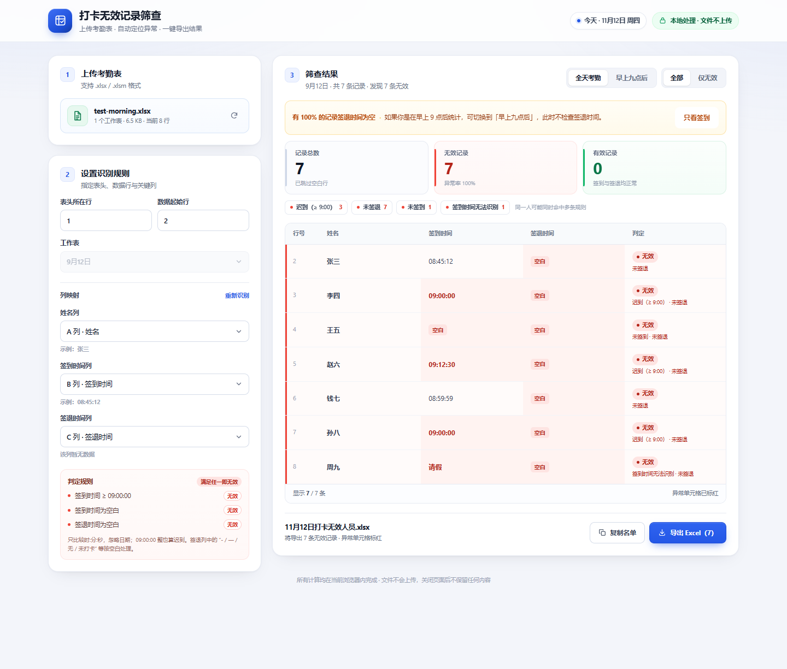
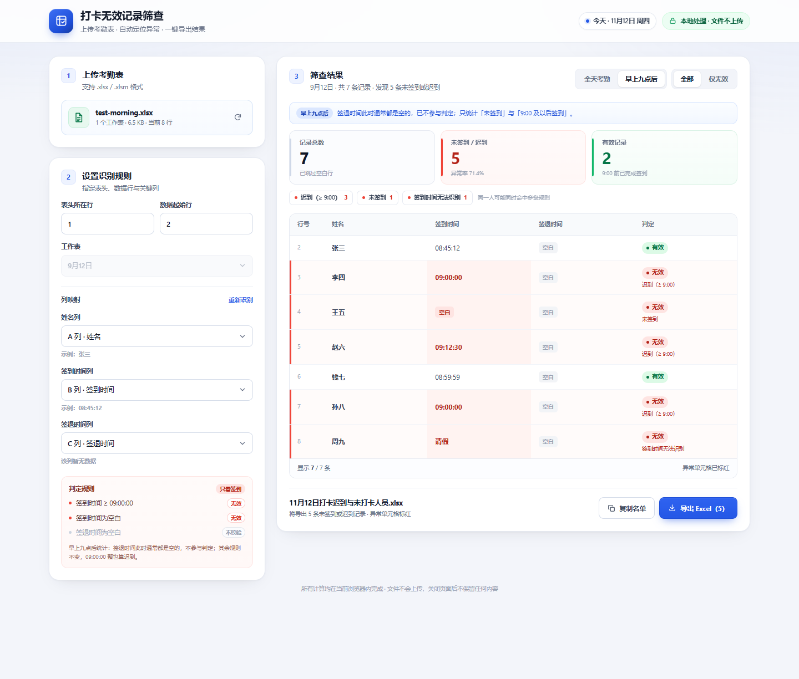

# 打卡无效记录筛查

> 上传考勤 Excel，自动找出**9:00 及以后签到（9:00 整也算迟到）**、**未签到**、**未签退**的记录，以及**加班卡签到/签退不合规**的记录，一键导出标红结果。
>
> 整个工具被构建成**一个 HTML 文件**，双击即可使用，不需要安装、不需要联网，文件也不会离开你的电脑。

**在线使用**：<https://blackjack513.github.io/execl-filter/>


## 功能特点

- **单文件、零安装**：构建产物 `dist/打卡无效记录筛查.html` 约 1 MB，双击用浏览器打开就能用，可放在 U 盘、群文件或内网共享盘里分发。
- **纯本地处理**：Excel 在浏览器内用 ExcelJS 解析，没有任何上传接口，关闭页面即清空，适合处理含真实姓名的考勤数据。
- **表头自动识别**：从表头里自动匹配「姓名 / 签到时间 / 签退时间」三列，也支持手动改选，兼容表头不在第一行、数据从任意行开始的表格。
- **多工作表**：自动列出所有工作表，可选择要筛查的那一张。
- **实时预览**：改表头行、数据起始行、列映射都会立刻重算；统计卡展示总数 / 无效 / 有效，并可只看无效记录。
- **一键导出**：导出 `.xlsx`，表头带样式，异常单元格标红加粗，含页码页脚；还可以一键复制无效人员名单。
- **早上九点后专项**：上午签退还没打卡时，切换到「早上九点后」场景，只看谁没签到、谁 9:00 及以后才签到，不会被整列空签退淹没。
- **加班卡识别**：考勤导出的「打卡类型」永远写「传统打卡」，因此改为按行结构识别——同一人同一天第一次出现算正常卡，第二次及以后算加班卡。加班段要求「签到 + 签退」齐全：只有加班签退、或签到签退都为空，都会单独标注；再按 18:00–19:00 签到、21:00 后签退判定（时间可在页面配置），跨天签退视为正常。普通考勤会自动排除加班卡，避免 18:30 签到被误判迟到。
- **时间格式兼容广**：Excel 时间单元格、日期时间单元格、`08:58`、`9:05:30`、`2026-11-09 09:15:00`、`上午9点05分` 等都能识别。

## 快速开始

### 方式一：在线打开（最省事）

直接访问 <https://blackjack513.github.io/execl-filter/>，上传考勤表即可。页面由 GitHub Pages 托管，但解析与导出仍然全部在你的浏览器里完成。

### 方式二：下载单文件离线使用

1. 下载 [`dist/打卡无效记录筛查.html`](dist/打卡无效记录筛查.html)（在 GitHub 上点开文件后选择 *Download raw file*）；
2. 双击打开，按页面提示拖入考勤表即可。

> 也可以把 `dist` 目录整个拷到内网共享盘，同事打开同一个文件就能用。

### 方式三：从源码构建

```bash
npm install
npm run build
```

构建完成后生成 `dist/打卡无效记录筛查.html`，模板、样式、ExcelJS 和业务脚本会被内联进这一个文件。线上版本由 `gh-pages` 分支提供，重新构建后把这一个文件复制成 `gh-pages` 分支根目录的 `index.html` 即可更新。

## 判定规则

### 普通考勤

满足任意一条即判定为**无效**：

| 规则 | 说明 |
| --- | --- |
| 签到时间 `≥ 09:00:00` | 只比较时:分:秒，忽略日期；**09:00:00 整也算迟到** |
| 签到时间为空白 | 包括 `-`、`—`、`无`、`未打卡` 等占位文本 |
| 签退时间为空白 | 同上，`-`、`—`、`无`、`未打卡` 等按空白处理 |

一条记录可以同时命中多条规则，结果页会分别统计「迟到（≥ 9:00）」「未签退」「未签到」的数量。

普通考勤只统计**非加班卡**。若表里识别出加班卡，会自动排除并在结果区提示，点击提示条即可切换到「加班打卡」检查。

### 加班卡

考勤系统导出的「打卡类型」列不可用（永远是「传统打卡」），加班卡按行结构识别：

- 同一人同一日期**第一次出现视为正常卡，第二次及以后视为加班卡**（不再依赖「打卡类型」列）；
- 有数据的加班卡：签到在 16:00 之后，或签到空白但签退不早于最早签退时间；
- 第二次出现但签到、签退**都为空**，也判为加班卡，并单独标注为**加班未打卡（签到、签退均为空）**；
- 第一次出现就是空白时，作为正常卡参与未打卡统计（同人同日只出现一次的全空记录不会被当成加班卡）。

识别出加班卡后，满足任意一条即判定为**加班异常**：

| 规则 | 默认值 | 说明 |
| --- | --- | --- |
| 签到不在加班签到时间段 | 18:00–19:00 | 早于 18:00 或晚于 19:00 都算异常，边界值算正常 |
| 签退早于最早签退时间 | 21:00 | 21:00 整算正常；签退到次日凌晨视为跨天正常 |
| 缺加班签到（仅签退） | — | 加班段只有签退、没有签到；结果表会加橙色「仅签退」标记，导出原因单元格用橙色底纹 |
| 加班未打卡（签到、签退均为空） | — | 同人同日第二次出现但两个时间都空；结果表会加红色「未打卡」标记，导出原因单元格用红色底纹 |
| 签到或签退为空白 | — | 包括 `-`、`—`、`无`、`未打卡` 等占位文本 |

三个时间都能在左侧「加班卡规则」里修改，改完立即按新口径重算；签到开始时间必须早于截止时间，否则会提示并恢复默认值。

## 三种统计场景

结果区右上角可以在三种场景之间切换，切换后立即按新口径重算统计、明细和导出：

| 场景 | 适用时机 | 判定口径 |
| --- | --- | --- |
| **全天考勤**（默认） | 下班后 / 次日汇总 | 签到、签退都检查，上表三条规则全部生效；加班卡自动排除 |
| **早上九点后** | 上午刚上班，签退还没发生 | 只看签到：未签到、`≥ 09:00:00` 签到才异常；签退空白（包括整列没填）不再算异常；加班卡自动排除 |
| **加班打卡** | 加班结束后 / 次日汇总 | 只看识别出的加班卡，按加班签到时间段和最早签退时间判定 |

早上九点后上传时，如果大部分记录的签退还是空的，结果区会提示「有 N% 的记录签退时间为空」，点提示条上的「只看签到」就能切换，不用手动改表。



切换后统计、明细、导出都按「只看签到」的口径重算，签退列里的空白会淡化成灰色，不再标红：



三种场景的导出也不同：

| 场景 | 文件名 | 列 |
| --- | --- | --- |
| 全天考勤 | `X月X日打卡无效人员.xlsx` | 姓名、签到时间、签退时间、异常原因 |
| 早上九点后 | `X月X日打卡迟到与未打卡人员.xlsx` | 姓名、签到时间、异常原因 |
| 加班打卡 | `X月X日加班打卡异常人员.xlsx` | 姓名、加班签到、加班签退、异常原因 |

缺加班签到（仅签退）的记录，结果表会显示橙色「仅签退」标记，导出时原因单元格用橙色底纹；加班未打卡（签到、签退均为空）的记录用红色「未打卡」标记和红色底纹。

## 使用说明

1. **上传考勤表**：支持 `.xlsx` / `.xlsm`，可拖拽或点击选择。
2. **设置识别规则**：
   - 表头所在行：表头默认在第 1 行，若表格上方有标题则可改为第 3 行等；
   - 数据起始行：默认是表头下一行；
   - 工作表：多张表时选择目标表；
    - 列映射：自动识别姓名、签到时间、签退时间三列，识别不准时手动在下拉框里改。
    - 若自动识别失败，点「重新识别」或手动指定列即可。
    - 加班签到/签退时间：在左侧「加班卡规则」中调整，默认 18:00–19:00 签到、21:00 起签退。
3. **查看并导出**：右侧实时显示统计、原因分布和明细；右上角可切换「全天考勤 / 早上九点后 / 加班打卡」，确认无误后点「导出 Excel」。

## 目录结构

```text
.
├── build.js                  # 构建脚本：把模板/样式/脚本/ExcelJS 打成单文件 HTML
├── package.json
├── src/
│   ├── index.template.html   # 页面结构（含占位符）
│   ├── style.css             # 页面样式
│   ├── core.js               # 纯函数核心：时间解析、普通/加班规则判定、表头自动识别、导出单元格转换
│   └── app.js                # 界面逻辑：读表、映射、预览、导出、复制
├── dist/
│   └── 打卡无效记录筛查.html  # 构建产物，可直接分发
└── docs/                     # README 截图
```

## 技术说明

- 原生 JavaScript，无框架，不使用打包器。
- [ExcelJS](https://github.com/exceljs/exceljs)（MIT）用于解析和生成 `.xlsx`，构建时以 `dist/exceljs.min.js` 内联进页面。
- `src/core.js` 以 UMD 方式导出，无 DOM 依赖，可在 Node 中直接 `require` 做单元测试。
- 日期采用 Excel 1900 日期系统；时间列若只有时间，导出时仍写成纯时间（`hh:mm:ss`），不凭空补日期。

## 隐私

所有解析、计算、导出都在当前浏览器内完成，页面没有任何网络请求，文件不会上传到任何服务器，也不会在本地存储中保留数据。

## License

[MIT](LICENSE)
